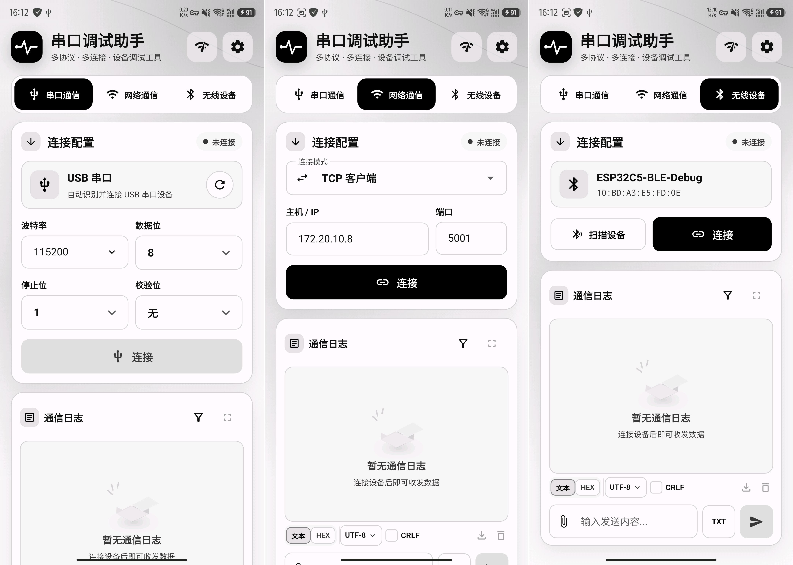

# SerialDbg

SerialDbg 是 Android 优先的原生 Flutter 串口与网络调试客户端。应用将 USB 串口、BLE、TCP 和 UDP 统一到同一个
通信工作台，以原始字节方式完成文本/HEX 收发、日志记录与导出、网络诊断和主题
配置。

## 项目预览



### INTERNET

<video src="assets/videos/wifi.mp4" controls width="100%"></video>

### BLE

<video src="assets/videos/ble.mp4" controls width="100%"></video>

### USB

<video src="assets/videos/usb.mp4" controls width="100%"></video>

## 功能列表

### 通信连接

- **USB 串口**：枚举 Android USB Host 设备、申请访问权限、选择设备和插拔监听；
  支持波特率 `50-4000000`、数据位 `5-8`、停止位 `1/1.5/2` 以及无/奇/偶/标记/
  空格校验。
- **BLE**：按 Android 版本申请权限，扫描并按 RSSI 排序；支持已命名/未命名筛选、
  GATT 自动发现、通知订阅、主动读取和特征写入。
- **BLE 特征选择**：优先选择同时支持写入和通知的服务；排除 Generic Access
  `0x1800` 和 Generic Attribute `0x1801`；未配置 Notify UUID 时允许只写连接。
- **TCP 客户端**：连接指定主机和端口，启用 `tcpNoDelay`，持续接收字节流。
- **TCP 服务端**：绑定监听地址并接受首个客户端；客户端断开后停止监听，需要重新
  开始监听才能接受下一个客户端。
- **UDP 客户端**：解析远端地址并使用临时本地端口，只接收配置远端地址和端口的数据。
- **UDP 服务端**：监听指定端口，记录最近一次数据报来源，并用该地址回复。

### 收发与协议

- 文本发送默认使用 UTF-8，可在当前会话切换为 ASCII。
- HEX 输入忽略 ASCII 空白，不接受 `0x` 前缀，要求偶数个字符并严格校验非法字符。
- 支持向文本或 HEX 负载追加 CRLF `0D 0A`，不会自动移除接收数据中的换行。
- 发送格式与接收展示格式相互独立；文本编码仅在当前会话生效。
- 单次负载编码和帧缓冲上限均为 `65536` 字节，UDP 单数据报发送上限为
  `65507` 字节。
- 增量帧解析支持分包、粘包、噪声恢复、非法长度、校验失败和缓冲溢出处理。
- 临时 `AA55` profile 为 `AA 55 | CMD | LEN | PAYLOAD | XOR`，`LEN` 最大
  `255`，XOR 覆盖 `CMD`、`LEN` 和 `PAYLOAD`。
- `AA55` 尚未接入 `HomeController`，当前首页不会自动封装或解析该协议帧，不能
  声明与原 APK 协议兼容。

### 日志与诊断

- 通信日志区分发送、接收和系统消息，支持全部/接收/发送筛选、自动滚动、全屏查看
  和全文搜索。
- 内存日志最多保留 `5000` 条或 `4 MiB`，超出后淘汰最早记录；单条日志最多渲染
  `8192` 个字符。
- 成功连接后创建日志会话，日志按批次写入 Drift，并在连接结束后裁剪到最近 20 个
  会话。
- 当前内存日志可通过 Android Storage Access Framework 导出为 UTF-8 文本，支持
  文本或 HEX 展示格式，不申请全盘存储权限。
- 网络诊断可读取本机非回环 IPv4 地址，并通过 Android 原生
  `InetAddress.isReachable()` 执行 Ping。
- 设置页支持跟随系统、浅色和深色模式，以及 FlexColorScheme 配色预设。

### 持久化与平台能力

- Drift schema 版本为 `3`，保存每种模式最近一次连接配置、应用设置、外观设置和
  通信会话。
- Android Manifest 声明网络、按 API 版本区分的 BLE 权限和可选 USB Host 能力。
- 不申请全盘存储权限；BLE 和 USB Host 不是强制硬件特性。
- `android:allowBackup="false"`、`android:usesCleartextTraffic="false"`。

主要限制：

- 尚无真实 USB 串口和 BLE 透传设备验收结果。
- 网络功能已有本机回环测试，但尚无 ESP32 和真实 Android 设备矩阵验收。
- 当前界面没有历史日志会话浏览、删除入口，也没有 BLE UUID 手工配置入口。
- 清空日志只清理当前内存日志，不删除已经写入数据库的历史会话。

## 项目结构

```text
lib/
  main.dart                 应用启动、依赖初始化和根 Widget
  app/
    di/                     GetIt 核心服务、传输工厂和页面控制器注册
    routes/                 GoRouter 路由定义
    models/                 连接配置、状态、日志、协议和诊断模型
    services/
      transport/            TCP、UDP、BLE、USB 统一 Transport 实现
      protocol/             负载编解码、增量帧解析和临时 AA55 profile
      logging/              内存日志、分批落库和文件导出
      ble/                  BLE 权限、扫描和 GATT 选择
      usb/                  Android USB 串口服务
      diagnostics/          本机 IPv4 和 Ping 诊断
    database/               Drift 数据库、表、仓库和生成代码
    pages/                  首页、设置页及页面控制器
    widgets/                跨页面 Widget 和视觉组件
    theme/                  FlexColorScheme 主题和扩展色
    utils/                  常量、输入校验、格式化和 BLE UUID 工具
test/
  app/                      模型、页面、服务、数据库和主题测试
  fixtures/                 协议基线向量
  widget_test.dart          Android 手机尺寸下的主要 Widget 流程测试
android/                    Android Host 工程、Manifest 和 MethodChannel
```

关键入口：

- `lib/main.dart`：初始化依赖、加载外观和通信偏好、启动应用。
- `lib/app/pages/home/home_controller.dart`：通信工作台状态和连接生命周期。
- `lib/app/services/transport/transport.dart`：所有传输通道的统一契约。
- `lib/app/services/transport/transport_factory.dart`：按连接模式创建 Transport。
- `lib/app/database/app_repository.dart`：数据库持久化边界。
- `test/fixtures/protocol_vectors.json`：HEX、文本和 `AA55` 协议基线。

`lib/app/database/database.g.dart` 由 `build_runner` 生成，不应手工修改。

## 快速开始

### 环境要求

当前环境基线为 Flutter `3.47.8`、Dart `3.13.7` 和 Java 17。首次运行前确认已安装
Flutter、Android SDK，并准备可用的 Android 设备或模拟器。

```bash
flutter --version
flutter pub get
```

### 运行应用

```bash
flutter devices
flutter run -d <device-id>
```

只有数据库表、序列化模型或其他代码生成输入发生变化时才需要执行：

```bash
dart run build_runner build --delete-conflicting-outputs
```

### 验证代码

```bash
dart format --output=none --set-exit-if-changed lib test
flutter analyze
flutter test
flutter build apk --debug
```

运行单个测试文件：

```bash
flutter test test/app/pages/home/home_controller_test.dart
```

BLE、USB 和网络改动应补充设备信息、Android 版本、真实硬件步骤和验收结果。
仅通过单元测试或 Widget 测试时，不得表述为真实设备已验证。

### 使用建议

- 网络调试优先使用可信局域网或本机回环，不通过明文 TCP/UDP 传输敏感数据。
- BLE 连接后若无法发送，先确认设备存在可写特征。
- USB 设备忙时，关闭占用同一串口的其他应用或系统服务。
- TCP 服务端接受过一个客户端后必须重新监听，才能接受下一个客户端。
- UDP 服务端必须先收到目标设备的数据报，才能向该设备回复。

### Android 自动发布

发布工作流位于 `.github/workflows/android-release.yml`。推送 `vX.Y.Z` 格式的
Git tag，或在 Actions 中手动输入一个已存在的发布标签后，工作流会执行格式检查、
代码生成、静态分析和测试，然后发布三个独立 APK：

- `armeabi-v7a`
- `arm64-v8a`
- `x86_64`

GitHub 仓库需要创建 `flutter_android_build` Environment，并配置以下 Secrets：

- `ANDROID_KEYSTORE_BASE64`：发布 keystore 的 Base64 内容，不能包含换行
- `ANDROID_KEYSTORE_PASSWORD`
- `ANDROID_KEY_ALIAS`
- `ANDROID_KEY_PASSWORD`

工作流会把 keystore 临时还原到 Runner 的系统临时目录，并在结束前删除。发布前
会逐个校验 APK 的 V2、V3 签名，Release 资产统一命名为
`serialdbg-<tag>-<abi>.apk`，同时上传 `SHA256SUMS.txt`。Dart 符号文件仅作为
Actions 产物保留 30 天，不进入 Release。

本地完全未设置上述签名环境变量时，Release 构建仍使用 debug 签名以便调试；
正式发布必须由工作流注入发布签名。

### 发布前检查

- `applicationId` 已设置为 `com.zhao.serial.dbg`，后续修改需评估应用升级和数据
  迁移影响。
- 配置正式签名，不使用当前 Debug 签名构建 Release。
- 确认应用名称、图标、版本号和发布渠道。
- 获取 `FlutterBluePlus` 所需的商业许可。
- 完成 BLE、USB、TCP/UDP 真实设备矩阵和安全验收。
- 确认导出日志、设备标识和网络暴露面的处理方式。
